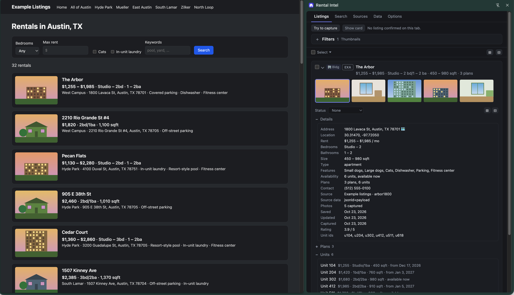
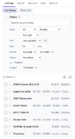
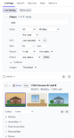
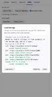
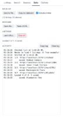
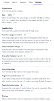

# rental-intel


Rental Intel is a Chrome extension that saves rental property listings from several online sources to a private, in-browser, searchable database. When conducting a housing search that might last weeks or even months, the goal of this tool is to provide a way of organizing and managing that process. Everything it collects stays on your device. There is no account, no server and no tracking.

[](https://rshaker.github.io/rental-intel/site/)

Support for each source site is implemented in the form of a plugin. This release includes plugins for **apartments.com** and **zillow.com**, and a third for [Example Listings](https://rshaker.github.io/rental-intel/site/), an invented rental site of fictional Austin listings, so you can try the extension before enabling a real site. Adding another data source requires creating one folder of code under [src/sources/](src/sources/) for each new site.

## Installation

**Option A:** The [Chrome Web Store](https://chromewebstore.google.com/detail/rental-intel/hbflbgbfpdognacikoldmfeeeihidljp) is the simplest way to install the extension, and it
keeps the extension updated.

**Option B:** To install by hand, download the latest
`rental-intel-chrome-<version>.zip` from the
[releases](https://github.com/rshaker/rental-intel/releases) page and
unzip it. Then open `chrome://extensions`, turn on **Developer mode**, click
**Load unpacked** and choose the unzipped folder. An extension loaded this
way does not update itself.

**Option C:** To build it from source instead, with Node 22.12+ and Chrome 140+:

```sh
npm install
npm run build
```

Then load the `dist/` folder unpacked, as above.

## Usage

<table>
<tr>
<td width="108" valign="top"><a href="docs/images/usage/1-enable-a-site.png"></a></td>
<td valign="top"><b>1. Enable a site.</b> Open the side panel by clicking the extension's toolbar button, typing <code>Ctrl+Shift+Y</code> / <code>Cmd+Shift+Y</code>, or choosing <b>Show or hide Rental Intel</b> from the right-click menu of the button or of any page.<br><br>On the <b>Sources</b> tab, click <b>Enable</b> beside a site; Chrome will ask for permission to access that site only. Or just browse to the site: while it is off, the <b>Listings</b> tab says so and offers <b>Enable source</b>.<br><br>To try the extension without a real site, enable <b>Example listings</b> and open any listing on <a href="https://rshaker.github.io/rental-intel/site/">Example Listings</a>. Its rentals are invented, and nothing there is for rent.</td>
</tr>
<tr>
<td width="108" valign="top"><a href="docs/images/usage/2-open-a-listing.png"></a></td>
<td valign="top"><b>2. Open a rental listing</b> on an enabled site. The button at the top of the <b>Listings</b> tab says what a click would do: <b>Add listing</b>, <b>Update listing</b> (the page changed since the save), <b>Re-capture</b> (it matches), or <b>Try to capture</b> (nothing recognized; it saves what it can parse). Details and photos are stored locally. <b>Show card</b> jumps to the page's card.</td>
</tr>
<tr>
<td width="108" valign="top"><a href="docs/images/usage/3-search-and-filter.png"></a></td>
<td valign="top"><b>3. Search and filter.</b> The search box matches any word on a listing, including your notes (<code>Cmd/Ctrl+F</code> jumps to it). <b>Filters</b> narrow the list by kind, site, type, rent, rooms, features or status, and sort it. The features (pets, laundry, parking and the rest) are one set shared with the Search tab; each site's plugin maps what its page says onto them when a listing is captured.<br><br>Expand a card for its photos, its status and its sections: Details, Plans, Units, Amenities, Fees &amp; policies, Description, Notes and Links. Tick cards and <b>Delete</b> removes them. Notes and status survive a re-save.<br><br>The <b>Search</b> tab searches a site itself and lists what it finds, as links. Its filters (rent, rooms, pets, laundry, and the rest) are a set shared across sites; a site's form shows only the ones it can spell in its own search URL, and names the rest.</td>
</tr>
<tr>
<td width="108" valign="top"><a href="docs/images/usage/4-load-a-list.png"></a></td>
<td valign="top"><b>4. Load a list.</b> <b>Load URLs…</b> on the <b>Data</b> tab takes listing URLs, one per line, or a text file of them. <b>Check list</b> reports what it found; <b>Start</b> visits each one in the active tab and saves it. A page that is not recognized in time pauses the run: answer the site's check in the tab, or <b>Skip</b> the page.</td>
</tr>
<tr>
<td width="108" valign="top"><a href="docs/images/usage/5-back-up.png"></a></td>
<td valign="top"><b>5. Back up.</b> <b>Save to file…</b> writes a JSON backup and <b>Open file…</b> restores one; <b>Copy to clipboard</b> and <b>Paste JSON…</b> do the same through the clipboard. Import merges by listing. The <b>Activity</b> log records what the extension did.</td>
</tr>
<tr>
<td width="108" valign="top"><a href="docs/images/usage/6-options.png"></a></td>
<td valign="top"><b>6. Options.</b> Panel size, page timing for list runs and site searches, how many photos to save, the status a new listing starts with, and which Details rows show. Ctrl or ⌘ with <code>+</code>, <code>-</code> and <code>0</code> resize the panel while it has the focus.</td>
</tr>
</table>

## Tips

- A site is off until you enable it. Disabling it on the Sources tab gives the access back to Chrome; your saved listings stay.
- Sites may change their page structure. The **Sources** tab says when each site's reader was last checked against the site.

## Development

The extension's tests, store screenshots and demos run against the fake
rental site, [Example Listings](https://rshaker.github.io/rental-intel/site/),
rather than a real one. A release build reads the site at that published
address; the test build, the unit tests and the browser harness read it at
http://localhost:5174, and `SITE_ORIGIN` in the environment overrides either
(`SITE_ORIGIN=http://localhost:5174 npm run build:watch` points an everyday
build at the dev server).

* `npm run build` writes the extension to `dist/`
* `npm run test:unit` is the fast loop (vitest)
* `npm run playwright:test` runs the browser suite against the fake site
* `npm run site:dev` serves the fake site at http://localhost:5174
* `npm run zip` builds the release and checks the zip it writes
* `npm run playwright:upgrade` opens a database written by the previous release with this build
* `npm run docs` writes the API reference to `docs/dist/`
* `npm run readme:images` takes the Usage screenshots above from the fake site and writes them to `docs/images/usage/`

A source is one folder under [src/sources/](src/sources/) containing:
* [Descriptor](src/sources/example/descriptor.ts) -- hosts, URL shapes, search filters, the date it was last checked
* [URL module](src/sources/example/urls.ts) -- parses a listing id out of a URL and builds search URLs
* [Page module](src/sources/example/page.ts) -- detection checks, extraction, search results, bot challenges
* [Content script](src/sources/example/example.content.ts) -- the entry point injected into the site's pages
* [View](src/sources/example/view.tsx) -- the card's Details rows and sections that are source-specific

The [src/sources/example](src/sources/example) directory is a template for new sources. The fixtures under [playwright/fixtures/](playwright/fixtures/) are saved copies of the fake site's pages and show what each part reads; [example-home.html](playwright/fixtures/example-home.html), for instance, contains:

```html
<link rel="canonical" href="http://localhost:5174/l/pecan00b/" />
<script type="application/ld+json">…</script>
<main data-listing="pecan00b">
  <h1 data-field="name">118 Pecan St Unit B</h1>
  <p data-field="address">118 Pecan St Unit B, Springfield, IL 62704</p>
  <p data-field="pets">No pets</p>
```

## Design

- The extension drives the user's own active tab and never fetches a listing page itself. Sites' bot detection accepts only a browser showing a page to a person, and a hidden tab gets no animation frames. The user may be challenged by the site, and the extension is designed to expect delayed page loads for this reason.
- The database (IndexedDB) lives in the extension origin and both the side panel and the service worker open it directly. The worker writes captures and photos; the panel writes the user's own edits, settings and backups, and reads everything through Dexie live queries, so a write from either context updates the panel.
- Content scripts are registered only for the sources the user has enabled, and they only answer questions about their page: they never speak first and never touch storage. A source may add a main-world script to read the page's own JavaScript state; Zillow is the only one that currently does so.
- A page is confirmed as a listing when its URL matches a pre-defined pattern and the page's own checks (structured data, canonical link, layout markers) add up to the same listing. A manual capture needs only a listing id.

## License

[MIT](LICENSE)
